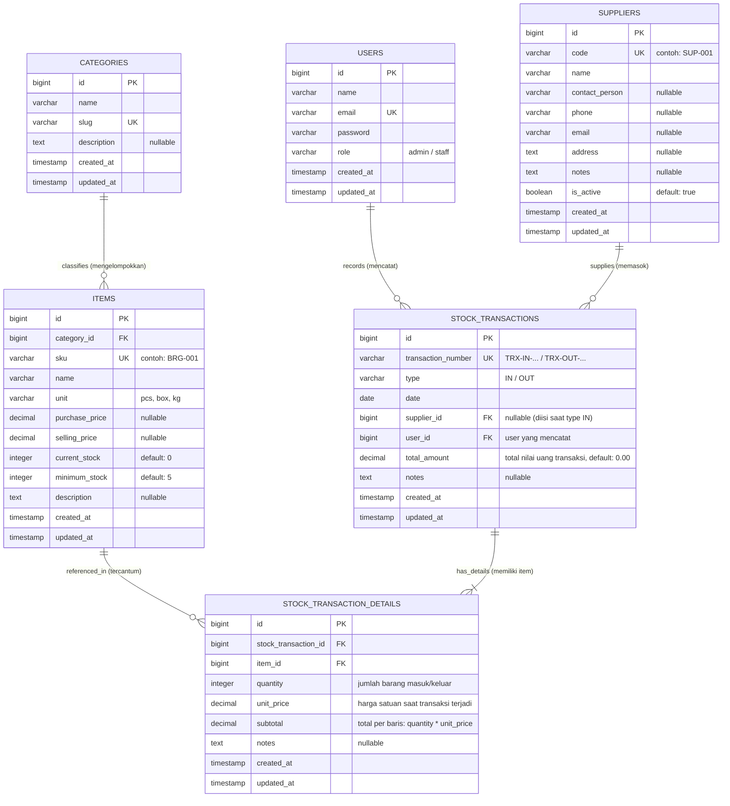

# Entity Relationship Diagram (ERD): Sistem Stok Barang

Dokumen ini memuat perancangan struktur relasional basis data PostgreSQL untuk Sistem Informasi Stok Barang UMKM.

---

## 1. Visualisasi ERD (Mermaid)

---

## 2. Kamus Data (Data Dictionary)

### A. Tabel `users`
Menyimpan data otentikasi dan otorisasi pengguna sistem.
- `id` (PK, BigInteger, Auto Increment)
- `name` (VARCHAR 255): Nama lengkap pengguna.
- `email` (VARCHAR 255, Unique): Alamat email untuk login.
- `password` (VARCHAR 255): Hash kata sandi akun (Bcrypt/Argon2).
- `role` (VARCHAR 50): Peran pengguna (`admin` atau `staff`).

### B. Tabel `categories`
Menyimpan klasifikasi barang agar mudah difilter.
- `id` (PK, BigInteger, Auto Increment)
- `name` (VARCHAR 100): Nama kategori (contoh: *Bahan Pokok*, *Kemasan*).
- `slug` (VARCHAR 120, Unique): Identifier URL / slug.
- `description` (TEXT, Nullable): Deskripsi singkat kategori.

### C. Tabel `suppliers`
Menyimpan data pemasok untuk transaksi pengadaan barang masuk.
- `id` (PK, BigInteger, Auto Increment)
- `code` (VARCHAR 50, Unique): Kode unik supplier (contoh: `SUP-001`).
- `name` (VARCHAR 255): Nama supplier / nama CV/PT/Toko.
- `contact_person` (VARCHAR 150, Nullable): Nama PIC / sales.
- `phone` (VARCHAR 30, Nullable): Nomor HP / WhatsApp.
- `email` (VARCHAR 255, Nullable): Email resmi supplier.
- `address` (TEXT, Nullable): Alamat pengiriman / kantor.
- `notes` (TEXT, Nullable): Catatan kerja sama atau rekening pembayaran.
- `is_active` (BOOLEAN, Default `true`): Status aktif.

### D. Tabel `items`
Menyimpan master data persediaan barang fisik.
- `id` (PK, BigInteger, Auto Increment)
- `category_id` (FK -> `categories.id`, OnDelete Restrict)
- `sku` (VARCHAR 50, Unique): Stock Keeping Unit pengenal unik barang.
- `name` (VARCHAR 255): Nama barang.
- `unit` (VARCHAR 50): Satuan barang (`pcs`, `kg`, `box`, dll).
- `purchase_price` (DECIMAL 12,2, Nullable): Estimasi harga beli acuan.
- `selling_price` (DECIMAL 12,2, Nullable): Estimasi harga jual acuan.
- `current_stock` (INTEGER, Default 0): Jumlah stok aktual saat ini.
- `minimum_stock` (INTEGER, Default 5): Ambang batas peringatan stok menipis.
- `description` (TEXT, Nullable): Keterangan spesifikasi barang.

### E. Tabel `stock_transactions`
Header transaksi pergerakan persediaan (Barang Masuk atau Barang Keluar) beserta nilai finansial.
- `id` (PK, BigInteger, Auto Increment)
- `transaction_number` (VARCHAR 60, Unique): Nomor transaksi otomatis (misal: `IN-20261012-001`).
- `type` (VARCHAR 10): Jenis transaksi (`IN` untuk Masuk, `OUT` untuk Keluar).
- `date` (DATE): Tanggal terjadinya transaksi fisik.
- `supplier_id` (FK -> `suppliers.id`, Nullable, OnDelete Restrict): Supplier asal barang (diisi jika `type = IN`).
- `user_id` (FK -> `users.id`, OnDelete Restrict): Akun staf/admin yang mencatat transaksi.
- `total_amount` (DECIMAL 14,2, Default 0.00): Akumulasi nilai uang keseluruhan transaksi (total pembelian atau total nilai pengeluaran barang).
- `notes` (TEXT, Nullable): Keterangan / alasan pengeluaran / nomor faktur manual.

### F. Tabel `stock_transaction_details`
Detail item barang, kuantitas, serta harga satuan dan subtotal transaksi.
- `id` (PK, BigInteger, Auto Increment)
- `stock_transaction_id` (FK -> `stock_transactions.id`, OnDelete Cascade)
- `item_id` (FK -> `items.id`, OnDelete Restrict)
- `quantity` (INTEGER): Kuantitas barang yang berpindah (wajib > 0).
- `unit_price` (DECIMAL 12,2, Default 0.00): Harga satuan aktual saat transaksi terjadi (*snapshot price*).
- `subtotal` (DECIMAL 14,2, Default 0.00): Total nilai baris item (`quantity * unit_price`).
- `notes` (TEXT, Nullable): Catatan per item (kondisi barang, diskon per item, dll).
