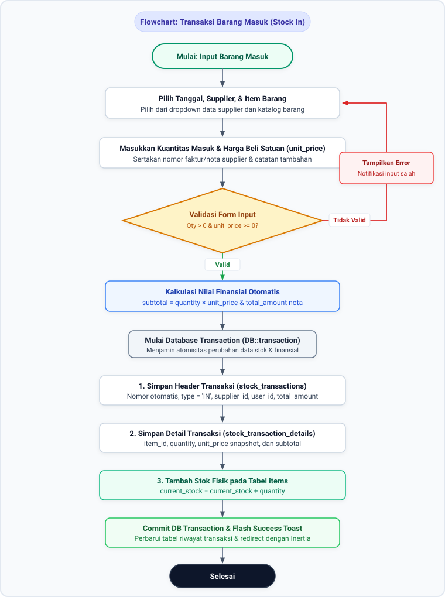
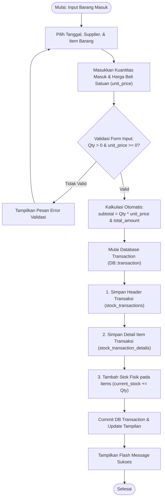
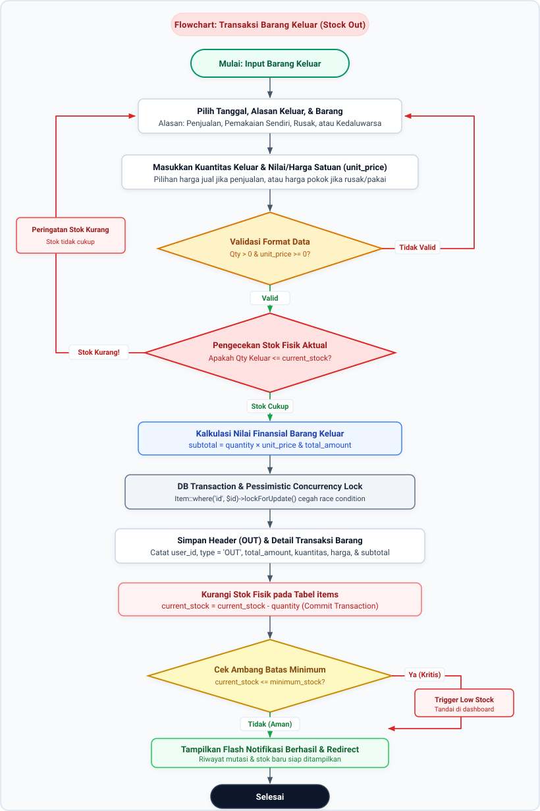
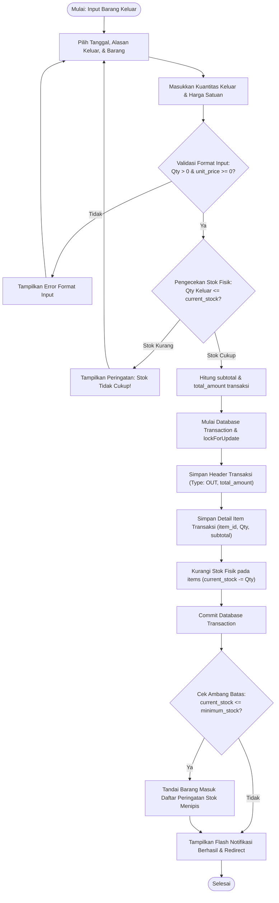
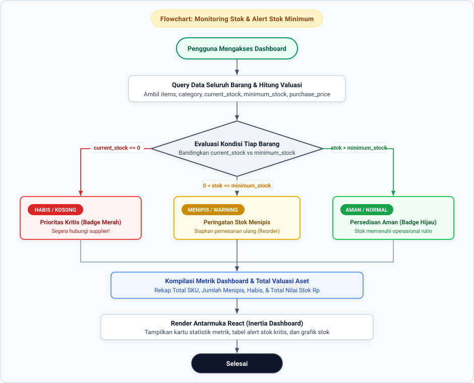
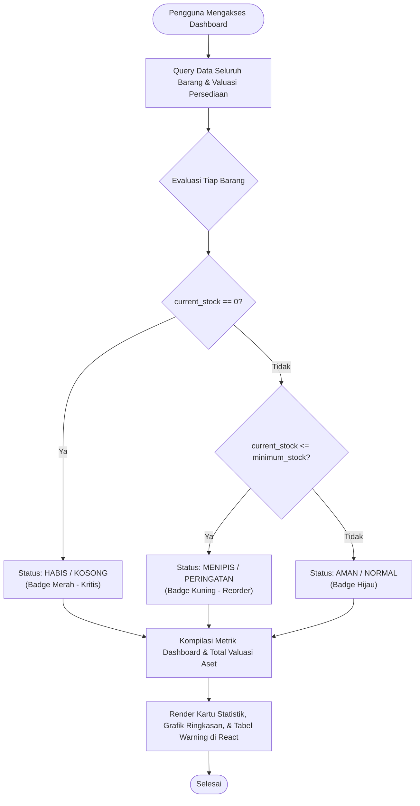
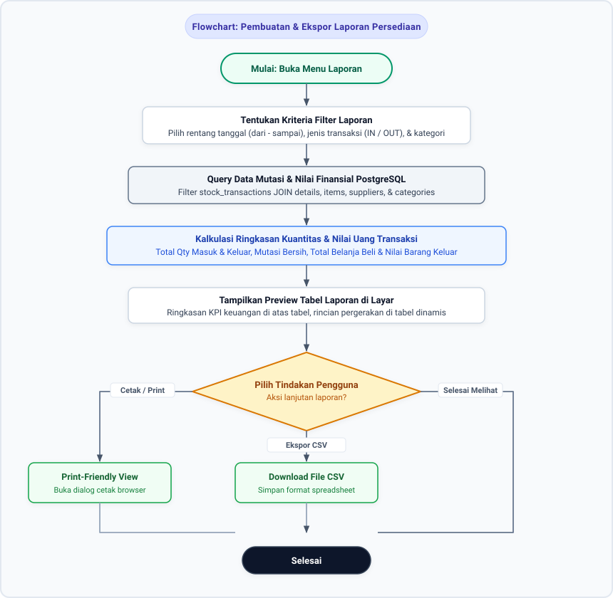
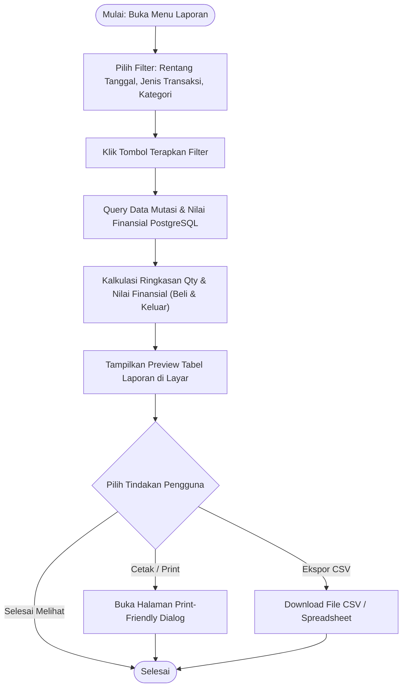

# Flowchart Alur Bisnis Sistem Stok Barang UMKM

Dokumen ini memuat diagram alir (*flowchart*) proses bisnis utama sistem stok barang UMKM. Diagram disajikan dalam format **vektor SVG beresolusi tinggi** yang bebas distorsi teks, disertai kode sumber Mermaid untuk kebutuhan dokumentasi.

---

## 1. Flowchart Transaksi Barang Masuk (*Stock In*)

Diagram ini menggambarkan alur pencatatan penerimaan persediaan barang dari supplier, pencatatan harga beli satuan (*unit price*), perhitungan subtotal/total faktur, dan penambahan stok secara atomik.

<b>Klik untuk melihat kode Mermaid (Stock In)</b>

---

## 2. Flowchart Transaksi Barang Keluar (*Stock Out*)

Diagram ini menggambarkan alur pengurangan stok akibat penjualan, pemakaian, atau kerusakan barang dengan proteksi stok negatif, kalkulasi finansial, dan penguncian *concurrency* (*pessimistic locking*).

<b>Klik untuk melihat kode Mermaid (Stock Out)</b>

---

## 3. Flowchart Monitoring Stok & Peringatan Stok Minimum (*Low Stock Alert*)

Diagram ini menggambarkan mekanisme logika sistem dalam mengevaluasi kuantitas stok setiap barang secara berkala untuk menentukan kategori status ketersediaan di Dashboard.

<b>Klik untuk melihat kode Mermaid (Monitoring & Alert)</b>

---

## 4. Flowchart Pembuatan & Ekspor Laporan Persediaan

Diagram ini menggambarkan alur pencarian, filter periode transaksi, kalkulasi rekap finansial, hingga pencetakan dokumen atau ekspor berkas spreadsheet (CSV).

<b>Klik untuk melihat kode Mermaid (Laporan Persediaan)</b>

