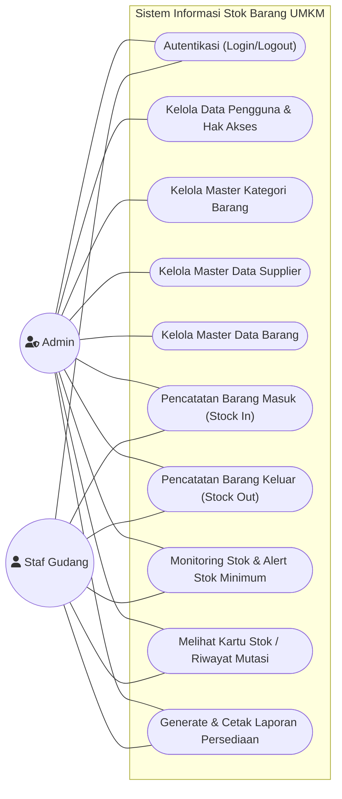

# Use Case Diagram: Sistem Informasi Stok Barang UMKM

Dokumen ini mendefinisikan aktor sistem dan use case yang menggambarkan interaksi antara pengguna dengan fungsionalitas sistem stok barang.

---

## 1. Definisi Aktor
1. **Admin (Pemilik / Pengelola Utama)**:
   - Memiliki akses penuh (*full access*) ke seluruh modul sistem.
   - Berwenang mengelola data pengguna (hak akses), master data (supplier, kategori, barang), transaksi, dan laporan.
2. **Staf Gudang (Operator Persediaan)**:
   - Berwenang mencatat transaksi barang masuk dan barang keluar.
   - Memantau ketersediaan stok fisik dan peringatan stok menipis.
   - Melihat riwayat kartu stok barang.

---

## 2. Diagram Use Case (Mermaid)

---

## 3. Matriks Hak Akses (Aktor vs Use Case)

| No | Use Case | Admin | Staf Gudang | Keterangan |
|---|---|:---:|:---:|---|
| 1 | Autentikasi (Login / Logout) | ✅ | ✅ | Mengamankan akses sistem via session login |
| 2 | Kelola Data Pengguna | ✅ | ❌ | Tambah staf baru, ubah role, reset kata sandi |
| 3 | Kelola Kategori Barang | ✅ | ❌ (Hanya View) | CRUD kategori pengelompokan barang |
| 4 | Kelola Data Supplier | ✅ | ❌ (Hanya View) | CRUD data pemasok bahan/barang |
| 5 | Kelola Data Barang & Stok Minimum | ✅ | ❌ (Hanya View) | CRUD master barang, setting threshold minimum |
| 6 | Transaksi Barang Masuk (*Stock In*) | ✅ | ✅ | Input penerimaan dari supplier, penambahan stok |
| 7 | Transaksi Barang Keluar (*Stock Out*) | ✅ | ✅ | Input pengeluaran barang, validasi stok cukup |
| 8 | Monitoring Stok & Alert Stok Minimum | ✅ | ✅ | Dashboard indikator stok aman/menipis/habis |
| 9 | Melihat Kartu Stok / Riwayat Mutasi | ✅ | ✅ | Kronologi pergerakan masuk-keluar per barang |
| 10 | Generate & Cetak Laporan Persediaan | ✅ | ✅ | Filter laporan per periode tanggal & cetak/ekspor |
